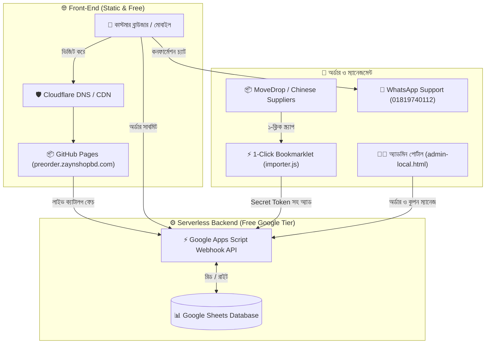
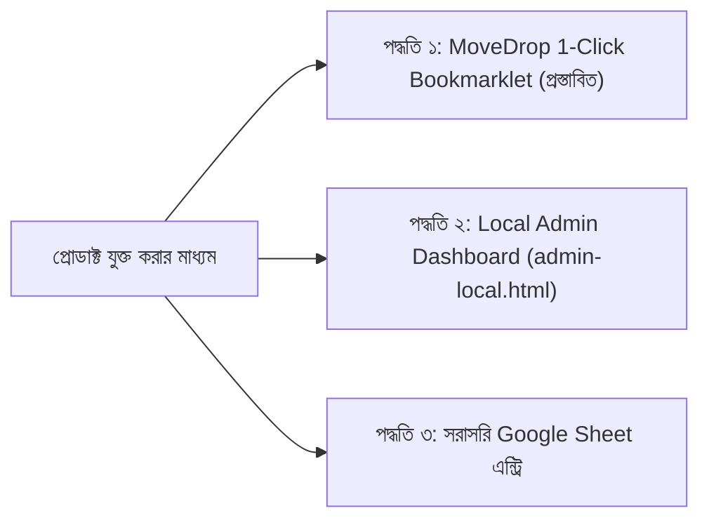

# 🛍️ Zayn Shop — System Architecture & Operations Manual
**ব্র্যান্ড:** Zayn Shop (Pre-Order Global Collection)  
**ডোমেইন:** [preorder.zaynshopbd.com](https://preorder.zaynshopbd.com)  
**আর্কিটেকচার:** ১০০% Zero-Hosting Cost (GitHub Pages + Cloudflare + Google Sheets Database + Apps Script Serverless API + WhatsApp Checkout)

---

## ১. প্রজেক্ট পরিচিতি ও আর্কিটেকচার সারসংক্ষেপ

Zayn Shop হলো একটি আধুনিক ই-কমার্স প্ল্যাটফর্ম, যার মূল লক্ষ্য চীন ও আন্তর্জাতিক সাপ্লায়ার (MoveDrop / 1688 / Taobao) থেকে ট্রেন্ডিং লাইফস্টাইল, জুয়েলারি, স্কিনকেয়ার ও গিফট আইটেম বাংলাদেশে প্রি-অর্ডার ও রেডি স্টকে বিক্রি করা। 

সাইটটির সবচেয়ে বড় বিশেষত্ব হলো—**এটির মাসিক হোস্টিং ও ডাটাবেস খরচ শূন্য (৳০ / $0)**। কোনো পেইড সার্ভার, ভিপিএস, বা পেইড ডাটাবেস ছাড়াই এটি দারাজ বা শপিফাইয়ের মতো মসৃণ ও দ্রুত লোড হয়।

### 🏗️ সিস্টেম ওয়ার্কফ্লো ডায়াগ্রাম:

---

## ২. ব্যবহৃত টেকনোলজি স্ট্যাক (Tech Stack)

| কম্পোনেন্ট | প্রযুক্তি | খরচ | দায়িত্ব |
| :--- | :--- | :--- | :--- |
| **হোস্টিং ও স্টোরফ্রন্ট** | GitHub Pages | **৳০** | HTML/JS/CSS স্ট্যাটিক ফাইল হোস্ট ও পরিবেশন। |
| **ডোমেইন ও SSL** | Cloudflare Free DNS | **৳০** | কাস্টম ডোমেইন রাউটিং, ডিডিওএস সুরক্ষা ও ফ্রি এসএসএল। |
| **ডাটাবেস** | Google Sheets | **৳০** | প্রোডাক্ট ক্যাটালগ, কাস্টমার অর্ডার, কুপন ও রিভিউ স্টোরেজ। |
| **ব্যাকএন্ড API** | Google Apps Script | **৳০** | সার্ভারলেস API (অর্ডার প্রসেসিং, কুপন ভ্যালিডেশন, ট্র্যাকিং)। |
| **অর্ডার ও সাপোর্ট** | WhatsApp Web API | **৳০** | গ্রাহকের সাথে ম্যানুয়াল পেমেন্ট ভেরিফিকেশন ও সাপোর্ট। |
| **ইমপোর্টার ইঞ্জিন** | Vanilla JS Bookmarklet | **৳০** | MoveDrop থেকে ১-ক্লিকে প্রোডাক্ট স্ক্র্যাপ ও শিটে সিঙ্ক। |

---

## ৩. স্টোরফ্রন্ট যেভাবে কাজ করে (Customer Journey)

### ১. লাইভ ক্যাটালগ ও ডুয়েল স্টক সিস্টেম:
* গ্রাহক সাইটে ঢুকলে `app.js` স্বয়ংক্রিয়ভাবে গুগল শিটের `Products` ট্যাব থেকে ক্যাশ-বাস্টিং সহ লাইভ প্রোডাক্ট ফেচ করে।
* **ডুয়েল স্টক সাপোর্ট:**
  - 🟢 **Ready Stock (২–৩ দিনে ডেলিভারি):** ঢাকার ওয়্যারহাউসে থাকা রেডি প্রোডাক্ট।
  - ✈️ **Pre-Order (১৫–২৫ দিনে ডেলিভারি):** বিদেশ থেকে অন-ডিমান্ড ইম্পোর্ট করা প্রোডাক্ট।
* **ইনস্ট্যান্ট সার্চ ও ফিল্টারিং:** গ্রাহক সার্চ বক্সে লিখলে বা Min/Max প্রাইস সেট করলে পেজ রিলোড ছাড়াই মিলিসেকেন্ডে প্রোডাক্ট ফিল্টার ও সর্ট হয়।
* **মোবাইল বটম নেভিগেশন বার:** মোবাইলে দারাজ/শপিফাই অ্যাপের মতো স্টিকি বটম বার থাকে (হোম, ক্যাটাগরি, ব্যাগ, ট্র্যাকিং, হোয়াটসঅ্যাপ)।

### ২. প্রোডাক্ট ডিটেইলস ও ভেরিয়েন্ট পেজ (`product.html`):
* **ভেরিয়েন্ট সিলেক্টর:** প্রোডাক্টের সাইজ (S, M, L, XL) ও কালার (Gold, Silver ইত্যাদি) সিলেক্ট করার ইন্টারেক্টিভ পিল বাটন।
* **মাল্টিপল ইমেজ গ্যালারি:** মেইন ছবির নিচে ছোট থাম্বনেইল স্ট্রিপ। ক্লিক করলেই মেইন ছবি বদলে যায় এবং ছবিতে ক্লিক করলে লাইটবক্স জুম ওপেন হয়।
* **কাস্টমার রিভিউ:** ভেরিফায়েড রিভিউ ডিসপ্লে এবং নতুন রিভিউ সাবমিট করার ফর্ম (যা মডারেশন কিউতে জমা থাকে)।
* **রিলেটেড প্রোডাক্টস:** একই ক্যাটাগরির অন্যান্য জনপ্রিয় প্রোডাক্ট রেকমেন্ড করে।

### ৩. অর্ডার ও চেকআউট সিস্টেম (`order.html`):
* **ডেলিভারি চার্জ:** ঢাকা মেট্রো ৳৭০, ঢাকার বাইরে ৳১৩০।
* **৬৪ জেলা ও উপজেলা অটো-ম্যাপ:** ঢাকার বাইরে সিলেক্ট করলে বাংলাদেশের সব ৬৪ জেলা এবং স্বয়ংক্রিয় উপজেলা/থানা ড্রপডাউন আসে।
* **বাংলা সংখ্যা কনভার্সন:** গ্রাহক বাংলা সংখ্যা (০-৯) লিখলেও সিস্টেম স্বয়ংক্রিয়ভাবে ইংরেজি ডিজিটে কনভার্ট করে।
* **কুপন / প্রোমো কোড ইঞ্জিন:** গ্রাহক কুপন কোড (যেমন: `WELCOME50`) দিলে সার্ভারে গুগল শিট যাচাই করে ডিসকাউন্ট দেয়।
* **৳২০০ অগ্রিম প্রি-অর্ডার পলিসি:** মোট বিল থেকে ৳২০০ টাকা বিকাশ/নগদে অ্যাডভান্স করতে হয় এবং বাকি টাকা Cash on Delivery — এই হিসাব স্বয়ংক্রিয়ভাবে স্ক্রিনে ফুটে ওঠে।
* **অর্ডার সাবমিশন:** ফর্ম সাবমিট হওয়া মাত্র:
  1. Google Sheet-এর `Orders` ট্যাবে সমস্ত তথ্য ও ভেরিয়েন্ট ডিটেইলস সহ সেভ হয়।
  2. স্বয়ংক্রিয়ভাবে WhatsApp ওপেন হয়ে সম্পূর্ণ প্রি-ফিল্ড মেসেজ নিয়ে সাপোর্ট প্রতিনিধির সাথে চ্যাট শুরু হয়।

### ৪. লাইভ অর্ডার ট্র্যাকিং পেজ (`track.html`):
* গ্রাহক নিজের **Order ID** (যেমন: `ZS-261102-1042`) অথবা **ফোন নম্বর** দিয়ে যেকোনো সময় অর্ডারের অগ্রগতি দেখতে পারেন।
* ৫-ধাপের ভিজ্যুয়াল প্রগ্রেস বার:
  1. 📦 **Order Placed** (অর্ডার গ্রহণ করা হয়েছে)
  2. 💳 **Advance Confirmed** (৳২০০ অগ্রিম কনফার্মড)
  3. 🏭 **Processing / Sourced** (সাপ্লায়ার থেকে প্রস্তুত হচ্ছে)
  4. 🚚 **Shipped via Courier** (কুরিয়ারে হস্তান্তর—ট্র্যাকিং নম্বর সহ)
  5. ✅ **Delivered** (সফল ডেলিভারি সম্পন্ন)

---

## ৪. নতুন প্রোডাক্ট যুক্ত করার পদ্ধতি (Product Management Guide)

প্রোডাক্ট যুক্ত করার জন্য আপনার কাছে ৩টি ভিন্ন সহজ উপায় রয়েছে:

### পদ্ধতি ১: MoveDrop ১-ক্লিক বুকমার্কলেট (সবচেয়ে দ্রুত ও জাদুকরী) ⚡

MoveDrop বা চাইনিজ সাপ্লায়ারের সাইট থেকে মাত্র ৫ সেকেন্ডে সব তথ্য সহ প্রোডাক্ট স্টোরে তোলার উপায়:

1. **বুকমার্কলেট সেটআপ (একবারের কাজ):**
   - `admin-local.html` ফাইলটি ব্রাউজারে ওপেন করুন।
   - টপ ব্যানারে থাকা **`+ Zayn MoveDrop Importer`** বাটনটি মাউস দিয়ে টেনে আপনার ব্রাউজারের বুকমার্কস বারে (Bookmarks Bar) ছেড়ে দিন।
2. **প্রোডাক্ট ইমপোর্ট করার নিয়ম:**
   - ব্রাউজারে [MoveDrop (movedrop.global)](https://movedrop.global) বা সাপ্লায়ার পেজে গিয়ে যে প্রোডাক্টটি তুলতে চান সেটি ওপেন করুন।
   - ব্রাউজারের বুকমার্কস বার থেকে **`+ Zayn MoveDrop Importer`**-এ ক্লিক করুন।
   - সাথে সাথে স্ক্রিনের ডান পাশে একটি সুন্দর পপআপ উইন্ডো ভেসে উঠবে:
     - প্রোডাক্টের হাই-রেজোলিউশন ইমেজ স্বয়ংক্রিয়ভাবে সিলেক্ট হবে।
     - অন্যান্য ছবিগুলো স্বয়ংক্রিয়ভাবে গ্যালারি থাম্বনেইল হিসেবে নিয়ে নেবে।
     - টাইটেল এবং বিডিটি সেল প্রাইস অটো-ডিটেক্ট হয়ে যাবে।
     - ডেসক্রিপশনের অপ্রয়োজনীয় এক্সপোর্ট টেক্সট ক্লিন করে স্পেসিফিকেশন বসিয়ে দেবে।
   - আপনি শুধু ক্যাটাগরি ও আপনার পছন্দসই বিক্রয়মূল্য (Sale Price) ঠিক আছে কি না দেখে **"🚀 Import to Zayn Shop Store"** বাটনে ক্লিক করবেন।
3. **ফলাফল:**
   - প্রোডাক্টটি সাথে সাথে সিক্রেট টোকেন দিয়ে আপনার Google Sheet-এ অ্যাড হয়ে যাবে এবং আপনার ওয়েবসাইটে লাইভ দেখতে পাবেন!

---

### পদ্ধতি ২: লোকাল অ্যাডমিন প্যানেল (`admin-local.html`) 💻

ম্যানুয়ালি নিজস্ব কোনো প্রোডাক্ট তুলতে চাইলে:

1. আপনার কম্পিউটারের `f:\Antigravity\preorder-zaynshop\admin-local.html` ফাইলটি ব্রাউজারে ডাবল ক্লিক করে ওপেন করুন।
2. বাম পাশের ফর্মে:
   - প্রোডাক্টের নাম ও ক্যাটাগরি দিন।
   - বিক্রয়মূল্য ও রেগুলার প্রাইস দিন।
   - স্টক টাইপ নির্বাচন করুন: `Pre-Order` নাকি `Ready Stock`।
   - সাইজ (Sizes) এবং কালার (Colors) থাকলে কমা দিয়ে লিখুন (যেমন: `S, M, L` বা `Gold, Silver`)।
   - মেইন ছবির লিংক ও অতিরিক্ত ছবির লিংক দিন।
3. **"Publish Product to Store"** বাটনে ক্লিক করুন।
4. **অর্ডার ও কুপন ম্যানেজমেন্ট:**
   - অ্যাডমিন প্যানেলের **Orders** ট্যাবে গিয়ে কাস্টমারের অর্ডার স্ট্যাটাস (যেমন: Shipped, Delivered) পরিবর্তন করতে পারবেন এবং কুরিয়ারের ট্র্যাকিং কোড বসাতে পারবেন।
   - **Coupons** ট্যাবে গিয়ে যেকোনো উৎসব উপলক্ষে নতুন ডিসকাউন্ট কোড বানাতে পারবেন।
   - **Reviews** ট্যাবে গিয়ে গ্রাহকের জমা দেওয়া রিভিউ Approve বা Reject করতে পারবেন।

---

### পদ্ধতি ৩: সরাসরি Google Sheet-এ এন্ট্রি 📊

আপনার Google Sheet-এর `Products` ট্যাবে গিয়ে সরাসরি নতুন রো যোগ করতে পারেন:

| কলাম নাম | কী বসাবেন | উদাহরণ |
| :--- | :--- | :--- |
| **ID** | ইউনিক ৪-সংখ্যার আইডি | `1055` |
| **Name** | প্রোডাক্টের নাম | `Vintage Pearl Necklace` |
| **Category** | ক্যাটাগরি নাম | `Jewelry & Accessories` |
| **Price (৳)** | বিক্রয়মূল্য | `1250` |
| **Regular Price (৳)** | আগের দাম (কাটা দাগে দেখাবে) | `1600` |
| **Image URL** | মেইন ছবির লিংক | `images/prod_19.jpg` বা অনলাইন লিংক |
| **Description** | বর্ণনা ও স্পেক্স | `Premium quality imported necklace...` |
| **Badge** | ব্যাজ টাইপ | `Pre-Order` অথবা `In Stock` |
| **Status** | ভিজিবিলিটি | `Active` (লুকিয়ে রাখতে চাইলে `Hidden`) |
| **Additional Images** | অতিরিক্ত গ্যালারি ছবি | লিংকের পর লিংক (নতুন লাইনে) |
| **Stock Qty** | রেডি স্টক সংখ্যা (ঐচ্ছিক) | `10` (প্রি-অর্ডার হলে ফাঁকা রাখুন) |
| **Stock Status** | স্টক স্ট্যাটাস | `In Stock` অথবা `Pre-Order` |
| **Sizes** | সাইজ ভেরিয়েন্ট | `S, M, L, XL` |
| **Colors** | কালার ভেরিয়েন্ট | `Black, White, Blue` |

---

## ৫. নিরাপত্তা ব্যবস্থা (Security Features)

1. **Apps Script Secret Token Auth:**
   - গুগল শিটে ডাটা পরিবর্তন করার জন্য `adminToken` বাধ্যতামূলক। টোকেন ছাড়া বাইরের কেউ প্রোডাক্ট যোগ, ডিলিট বা কুপন মডিফাই করতে পারবে না।
2. **অ্যাডমিন প্যানেল লোকাল প্রোটেকশন:**
   - অ্যাডমিন প্যানেলে হোস্ট-লক সক্রিয়। এটি পাবলিক সার্ভার (`.github.io` বা কাস্টম ডোমেইনে) লোড হলে স্বয়ংক্রিয়ভাবে এক্সেস ব্লক করে লোকাল ব্যবহারের বার্তা দেখায়।
3. **Honeypot Bot Protection:**
   - অর্ডার ফর্মে অদৃশ্য ট্র্যাপ ফিল্ড (`website_url_hp`) বসানো আছে। ক্ষতিকারক কোনো অটোমেটেড স্প্যাম বট ফর্ম পূরণ করলে গুগল শিট তা নীরবে বাতিল করে দেয়।
4. **Concurrency LockService:**
   - একই সেকেন্ডে একাধিক ক্রেতা অর্ডার দিলে যাতে কোনো সারি হারিয়ে না যায়, সেজন্য `LockService` ব্যবহার করা হয়েছে।
5. **Google Sheet Source of Truth:**
   - গুগল শিটই মূল ডেটাবেস। শিট থেকে কোনো প্রোডাক্ট ডিলিট করলে তা সাইট থেকেও সম্পূর্ণ মুছে যায়।

---

## ৬. মাসিক খরচ ও সীমাবদ্ধতা (Cost & Limits)

* **মাসিক মোট খরচ:** **৳০.০০** (জিরো টাকা)
* **হোস্টিং ব্যান্ডউইথ:** আনলিমিটেড (GitHub Pages ও Cloudflare Free CDN)
* **ডাটাবেস কোটা:** গুগল শিটে প্রতি স্প্রেডশিটে ১ কোটি (10,000,000) সেল রাখা যায়, যা অন্তত ২০,০০০+ প্রোডাক্ট এবং ৫০,০০০+ অর্ডারের জন্য আজীবন যথেষ্ট।
* **Apps Script কোটা:** দৈনিক ২০,০০০টি পর্যন্ত ফ্রি রিকোয়েস্ট হ্যান্ডেল করতে পারে, যা প্রতিদিন কয়েক হাজার অর্ডারের জন্য যথেষ্ট।

---
*ডকুমেন্টেশন সংস্করণ: ২.১ | সর্বশেষ আপডেট: নভেম্বর ২০২৬*
